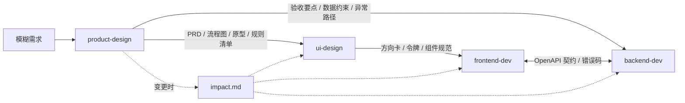

# 四角色协作架构

本仓库用四个角色覆盖「从模糊需求到可运行系统」的主干。角色之间是**单向交接**：每次交接必须带可验收的产物，而不是口头结论。

## 交接契约

| 从 | 到 | 必须交付 | 接收方检查什么 |
|---|---|---|---|
| product-design | ui-design | PRD、流程图、原型、R1…规则清单 | 规则是否都能在界面上找到落点；四态是否齐备 |
| product-design | frontend-dev | 验收要点、异常路径、原型 | 主路径是否三步内可达；错误是否可操作 |
| product-design | backend-dev | 数据约束、状态流转、外部依赖 | 不变量是否明确；异常与并发是否有出口 |
| ui-design | frontend-dev | 方向卡、DTCG 令牌、组件规范、原型 | 令牌是否齐全；组件状态是否有映射 |
| frontend-dev | backend-dev | 接口契约需求、错误码、分页/缓存语义 | 契约是否可实现；错误是否可分分支 |
| backend-dev | frontend-dev | OpenAPI、错误码、分页/缓存语义 | 契约是否与原型一致 |
| 任意角色 | 全部 | `impact.md`（变更影响表） | 五类影响是否覆盖：模块/接口/数据/测试/文档 |

## 产物归属

| 产物 | 归属 | 位置 |
|---|---|---|
| PRD、流程图、原型、评审、影响分析 | product-design | `requirements/<feature>/` |
| 方向卡、令牌、组件规范、UX 审查 | ui-design | `design/<feature>/` |
| 源码、单测、E2E、性能报告 | frontend-dev | `app/` |
| ADR、架构文档、OpenAPI、迁移、容量 | backend-dev | `docs/`、`api/`、`db/` |

## 变更怎么走

1. 任何角色发现需求/设计/契约需要变更，先在自己的产物里写变更点。
2. product-design 汇总成 `impact.md`：变更点 → 影响对象 → 影响类型 → 回归范围 → 文档同步。
3. 受影响角色按 `impact.md` 更新自己的产物，并在 PR 描述里引用该文件。
4. 破坏性变更（改契约、改令牌语义、删字段）必须走 major 版本，并在 CHANGELOG 写迁移说明。

## 角色不做什么

- product-design 不写最终代码，不做视觉决策。
- ui-design 不实现业务逻辑，不改接口契约。
- frontend-dev 不发明设计令牌，不绕过方向卡。
- backend-dev 不在没有约束（QPS/一致性/预算）的情况下给方案。

这四条是角色边界，也是评审时的第一道检查。
